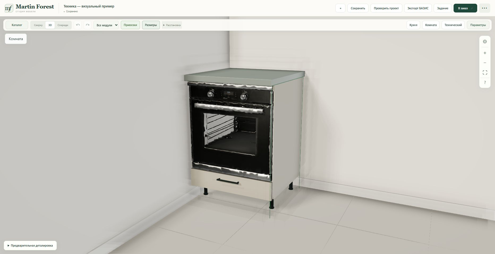
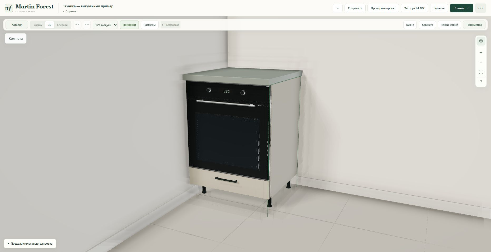
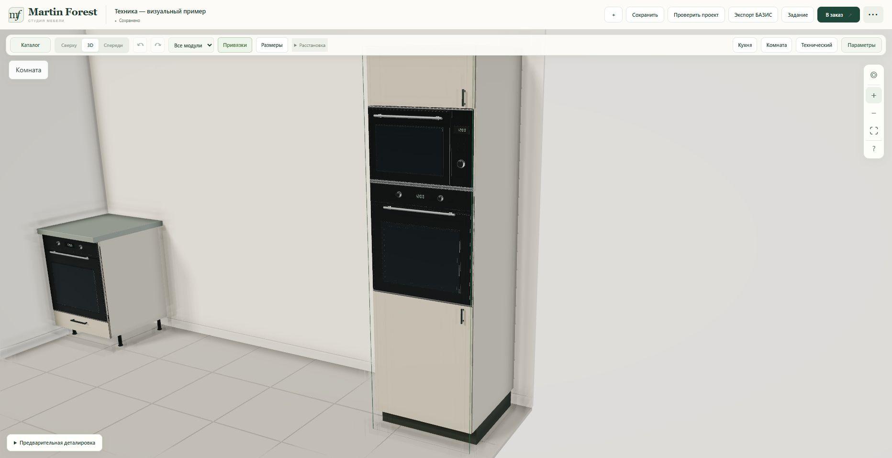
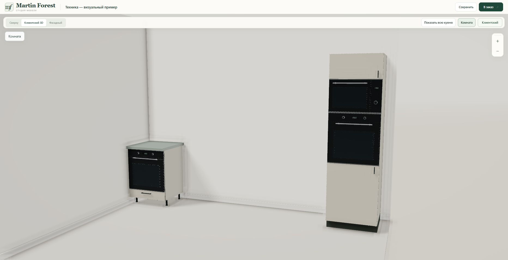

# Smooth appliance fronts — 23 October 2026

The user reported visible polygons on the oven and microwave. The former Tripo fronts also had warped handles and metal trim, so reducing normal-map strength alone could not correct the silhouette.

## Change

The textured Tripo body is retained behind a cut at normalized Z=0.43. Triangle clipping interpolates UVs and normals. A new shared presentation mesh replaces the uneven front: straight glass panels and trim, a smoked-glass window, rounded handles, 64-segment rotary controls and a small digital display. Separate glass, steel and dark-control materials provide clean reflections. The design is unbranded and illustrative.

Both geometries remain in the existing normalized envelope. Actual placement and sizes still come from `applianceLayout`: НШД-600, all tall-oven variants, and stacked oven/microwave variants use the same resources. The source GLBs, downloaded Tripo buffers/textures, production dimensions, niche/support/drawer geometry, BAZIS export and project data are unchanged. No new Tripo job or credit charge.

| Asset | Retained body triangles | New front triangles | Total |
|---|---:|---:|---:|
| Oven | 19,140 | 9,940 | 29,080 |
| Microwave | 22,970 | 8,268 | 31,238 |

The new front is built once per asset kind, with six material groups. Geometry and materials are shared by scene and catalogue instances and disposed by the asset owner. Loading/error faceplates and inspection visibility behavior remain supported. The public resource allowlist adds only `appliance-finish.mjs`.

## Verification

- 72 relevant Node checks passed. Coverage includes front envelopes, finite unit normals, triangle budget, clipping interpolation, resource sharing/disposal, НШД support/drawer clearance, all tall-appliance variants and existing mesh behavior.
- Static resource check passed for both modules and all original assets, including WebP decoding and denied unknown paths.
- Offline oblique renders inspected for both new fronts before release.
- Live browser review passed for the НШД oven and stacked oven/microwave in the tall cabinet, including the client presentation view. Straight front panels, round handles and controls replace the former warped silhouettes. No browser warnings or errors were captured. Thin reflective edges remain subject to normal screen-resolution aliasing.
- Both served JavaScript modules returned HTTP 200 and matched the local SHA-256 hashes after deployment.
- Runtime commit: `5bc245e96a15922ee09ecaedd9ad180bc64c7853`.
- Railway deployment `69b022ab-ed11-4dd8-839b-68723f5da79b` reached SUCCESS on 23 October 2026 at 22:37:49 Minsk (UTC+3). The existing isolated `martin-forest-v2-staging` service remains pinned to the runtime commit; these review images are a subsequent documentation-only commit.

## Before — live НШД view

## After — actual browser screenshots

