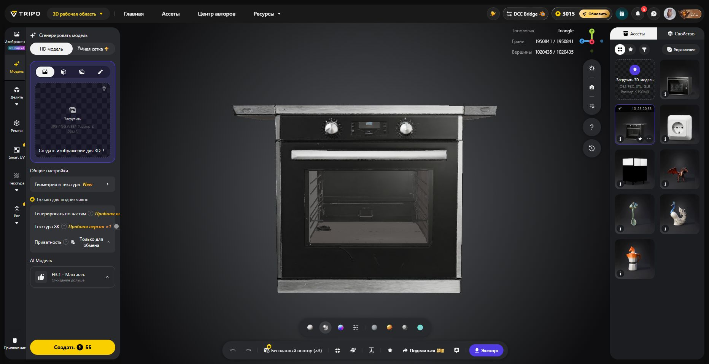
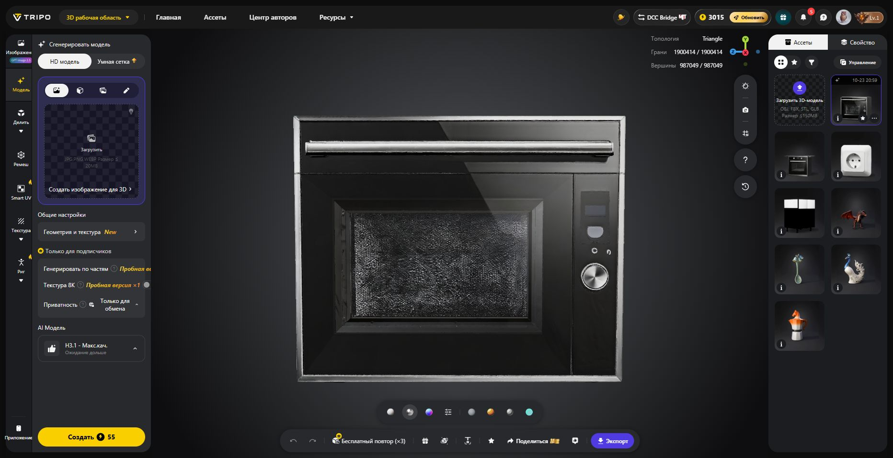

# Oven and microwave visuals — draft, awaiting exported meshes

**Not deployed.** Two Tripo H3.1 models have been generated in the user's existing Studio account. Export attempts through the connected browser did not deliver a file. This branch contains the integration scaffold and tests only; the actual mesh binaries and textures are still absent. Keep the live countertop release pinned until the assets are available, optimized, fitted and visually verified.

## Source assets

| Model | Tripo task | Cost | Original triangles |
|---|---|---:|---:|
| built-in oven 3d model | 493c506e-da6b-4ff3-bca2-846002d13cb8 | 55 credits | 1,950,841 |
| built-in microwave 3d model | d8ea151a-d744-4e31-8ea1-39a4d550d3c6 | 55 credits | 1,900,414 |

Total observed balance change: **3125 → 3015, 110 credits**. No paid remesh, upscale or regeneration was used. Generated via Studio UI because the Tripo CLI was not installed and no Tripo generation tool was exposed. Both models remain in the user's account.

- Oven: https://studio.tripo3d.ai/ru/workspace/generate/493c506e-da6b-4ff3-bca2-846002d13cb8
- Microwave: https://studio.tripo3d.ai/ru/workspace/generate/d8ea151a-d744-4e31-8ea1-39a4d550d3c6

Prompts requested isolated unbranded built-in appliances, black glass and brushed stainless steel, closed doors and realistic PBR materials. Oven requested a 595 × 595 × 550 mm envelope, two knobs, centre display and horizontal handle. Microwave requested a 595 × 380 × 350 mm envelope, left glass window, right display/dial and horizontal handle. These dimensions are prompt targets, not validated dimensions of the generated meshes.

## Remaining work

1. Obtain both original GLBs through the Tripo Export control. Export events timed out for microwave (60 s, twice) and oven (30 s); changing microwave to OBJ also did not yield an accessible file. A read of Chrome's internal download page was denied by the browser URL policy; no workaround was attempted.
2. Inspect geometry and textures offline. The oven preview includes an unwanted projecting top strip; remove that artifact before fitting. Microwave proportions also require normalization. The screenshots below are raw Tripo output, not the finished constructor appearance.
3. Adapt `scripts/build-socket-asset.py` for both appliances; simplify to about 20–30k triangles each, normalize front +Z/up +Y, compress PBR maps and record source hashes in manifests. Asset paths are fixed under `planner/appliance-assets/` with oven/microwave-tripo JSON, BIN and color/rm/normal WebP files.
4. Check niche fit in the actual renderer, including divider concealment, cabinet facades and handle projection. The current presentation envelopes are provisional.
5. Add asset-byte/MIME tests; verify cards, ordinary/inspection/hidden-front modes, save/reload and browser console in a separate demo project. Then pin the isolated Railway service to the completed commit and capture the final scene.

## Scaffold and verification

`appliance-assets.mjs` loads fixed same-origin resources lazily, validates geometry, shares GPU resources and retains measured faceplates if assets fail. The same MeshFactory serves the scene and catalogue; loaded resources refresh appliance thumbnails and do not overwrite manufacturer materials. Released previews reject late async attachments. No project schema, production geometry, FR3D sources, niche dimensions, BAZIS export, pricing, Bridge, database, environment or volume changes.

64 Node checks passed: 4 scaffold checks plus existing tall-appliance, production-notes and mesh tests. The new checks use fixture geometry, not the unavailable Tripo binaries. Actual mesh QA and deployment are **not complete**.

Branch: `mf-appliance-visuals-20261023`. Live runtime remains `d75325dd757473915b42fc9df7c45242132e5ad5` (countertop release).

