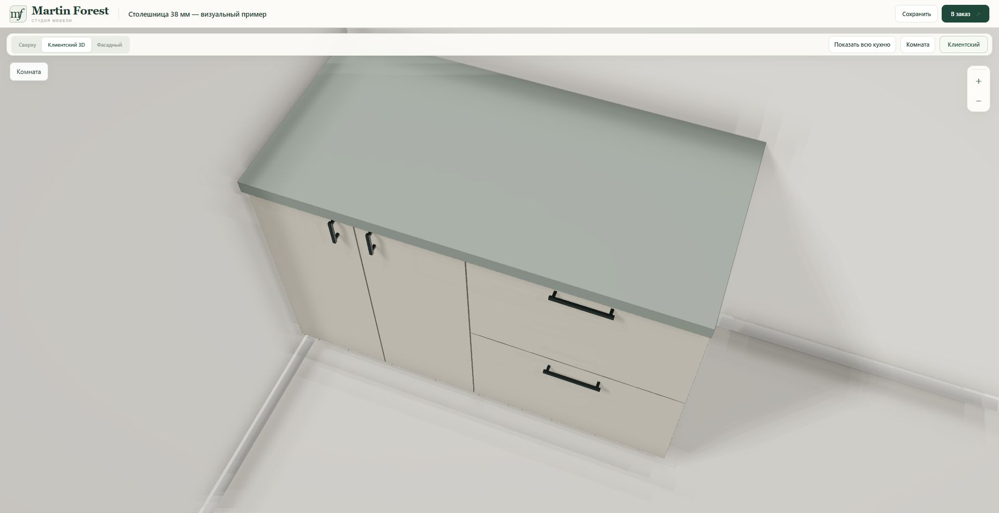
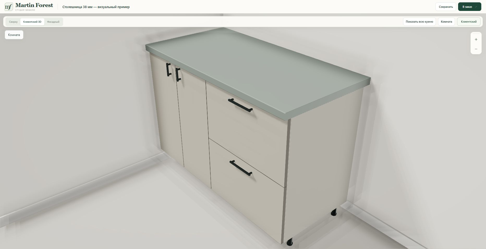

# Countertop presentation — 23 October 2026

The existing constructor now renders 38 mm countertops with a rounded postformed front edge, softly finished ends and restrained satin reflections. The front radius is a **4 mm presentation approximation**, not a manufacturer specification or a change to the FR3D source. Top and front UVs continue around the profile at physical scale; existing catalogue textures and explicit material roughness are retained.

The profile is applied inside the exact production footprint and 38 mm height. Rear/free-end rounding is 0.35/0.65 mm. Shared edges are detected in world space, including partial L/U contacts, stock-length joins and the original curved euro seams. Shared edges remain unrounded, with one subtle seam line. Full perimeter outlines appear only in the plan view. Straight legacy 38 mm tops receive the same visual profile; other saved thicknesses retain their previous geometry.

No project schema, cabinet dimensions, collision envelope, cut list, native export, pricing, donor asset, Bridge, database, environment variable or volume changes. No new Tripo asset is needed for this parametric presentation feature.

## Verification

- 74 relevant Node tests passed: 20 new visual checks plus existing countertop, mesh and presentation tests. The final legacy-box integration was verified again with the 55 affected mesh/visual checks.
- 5 Python checks passed: persistence, exact donor hashes/downloads, PDF dimensions and the public module allowlist boundary. One existing Starlette/httpx deprecation warning remains.
- Straight, left/right and U-shaped tops, ordinary/euro joints and all four rotations checked for finite unit normals, outward triangles, geometry inside source contours, exactly 38 mm thickness and unchanged native export. Continuous front UVs and full-height stock joints verified.
- 200 sequential countertop resizes left 136 cached geometries and zero live references after release.
- Browser: created the separate **Столешница 38 мм — визуальный пример** with two adjacent 600 mm base cabinets. Saved/reloaded it; UI still reports 1200 × 600 × 38 mm and overall height 858 mm. Checked client 3D, closer orbit and plan view; no console errors/warnings. The screenshots use the unassigned material preview colour, not a claimed manufacturer decor.

## Release

- Branch: `mf-countertop-visuals-20261023`
- Runtime commit: `d75325dd757473915b42fc9df7c45242132e5ad5`
- Railway service: `martin-forest-v2-staging`, `9aacf7bf-edd5-4f08-9423-3fbabea59268`
- Deployment: `caf051d2-a51d-4bf2-b71f-ff93c843a288`, **SUCCESS** at 17:43:50 UTC
- URL: https://martin-forest-v2-staging-production.up.railway.app/constructor.html
- This documentation/screenshots commit does not change the pinned runtime.

Before (higher orbit):

After (front and free end visible):

