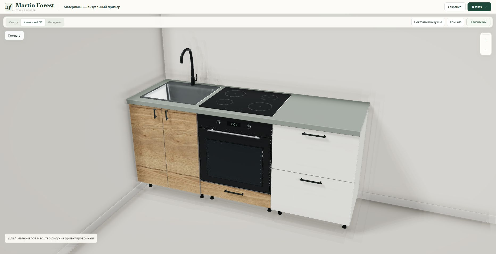
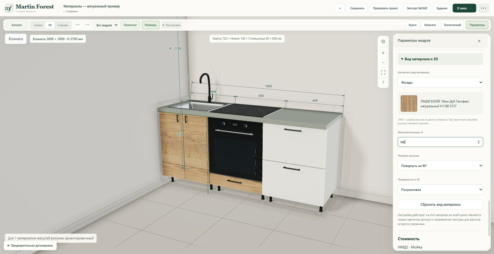

# Материалы — third agreed improvement

Implemented in the existing constructor and isolated Railway service. No new site or Tripo generation.

## Result

- Inspector: **Материалы → Вид материала в 3D**. Select the assigned facade, body, worktop or plinth material. A source swatch and material name identify the exact variant being adjusted.
- Pattern size 25–400%, relative rotation 0/90/180/270°, and auto/matte/satin/gloss finish. Larger percentage means a larger pattern; image aspect ratio remains fixed. Changes apply to that variant across the current kitchen and can be reset.
- Rounded panel faces retain their original UV projection plane through the bevel. Averaged corner normals no longer flip the texture onto another plane. Physical panel envelopes remain unchanged.
- Glossy sheet finishes use a dielectric clearcoat; matte wood/laminate stays nonmetallic. Existing glass and metal optics remain separate. No fabricated grain, normal maps, textures or manufacturer measurements were introduced.
- Seven existing PerfectSense PG variants now receive a gloss display preset automatically: F206 PG, U323 PG, U708 PG, U727 PG, U732 PG, U961 PG, W1000 PG. The small registry checks exact variant ID, material ID, full article and name after the existing full user-texture identity check. It does not replace or recolour images. Explicit per-variant visual metadata retains priority.

EGGER confirms **PG = high-gloss lacquer**, and PM/TM are matte surfaces:
https://www.egger.com/en/furniture-interior-design/decorative-collection/solutions/perfectsense-portfolio
Checked 23 October 2026. Renderer roughness/clearcoat values are visual presets, not measured EGGER values.

## Persistence and boundaries

`scene.displaySettings.materialAppearance[variantId]` stores only scale, relative rotation and finish. The validated additive field supports old projects without migration. Room/lighting changes preserve it; normal project save/load and history include it.

Article identities, manufacturing grain direction, production parts, cabinet geometry and native BAZIS data are not changed by these controls. No pricing, order, integration, secret, database-schema or production-system changes were made. Texture extents that were unconfirmed remain explicitly approximate; a manual percentage does not certify physical scale. USER_PREVIEW samples remain unmapped and missing visuals retain neutral fallback.

## Checks

- 61 Node checks passed: 37 across material appearance, existing materials, room settings and worktop geometry; 24 across fixtures, drawer materials, existing visuals and appliance smoothing.
- 36 Python checks passed: appearance validation/JSON roundtrip and exact PG identity checks, existing material attachments, fixture validation, fixed asset allowlisting. Existing Starlette/httpx deprecation warning only.
- Syntax and git whitespace checks passed. Texture rotation tested against physical dimensions with a nonsquare image; geometry UUIDs, production parts and identities remain stable under finish changes.
- Actual browser: 140% scale, 90° rotation and satin finish survived save/reload and changing room presets. Gloss → undo restored satin. Reset restored 100%/0°; undo restored 140%/90°. An invalid 500% entry reverted to its previous value. Material controls followed body/front selection independently.
- Six served JS/CSS assets matched local SHA-256 hashes; health returned HTTP 200 after the final deployment.
- No new browser warnings/errors after final deployment. One catalogue request failed during the earlier service restart; subsequent catalogue searches and saves succeeded.

Demo **Материалы — визуальный пример** was created as a copy, preserving the previous project. Its three cabinets use white W1000 ST9 carcasses, H1180 ST37 wood fronts (140%, 90°, satin), and W1000 PG fronts on the right drawer cabinet (automatic gloss). The worktop remains the neutral unassigned 38 mm visual. The copy's duplicate hob was removed to show the worktop surface.

## Publication

- Runtime implementation commit: `50ae6aba10bac508390ae3e11e93dc21307d33eb`.
- Final runtime commit: `c0733afa30590b1c839192faa3a182073fcd2468`.
- Final runtime tree: `b21d9d5501b8ab5884e1da92b4866a780a27c92e`.
- Railway deployment: `8ae28496-2243-4dfe-9d1e-7b68d8976a8f`, **SUCCESS** at **23:59:17 Minsk (UTC+3), 23 October 2026**.
- Existing isolated service stays pinned to the final runtime commit; this evidence commit does not deploy.
- Site: https://martin-forest-v2-staging-production.up.railway.app/constructor.html

## Actual browser captures

