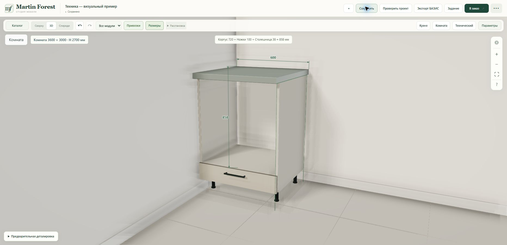
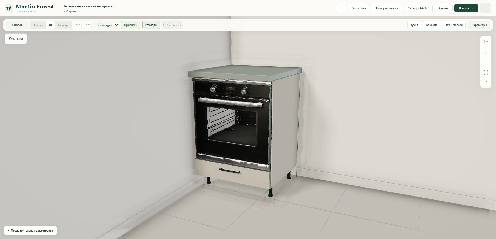
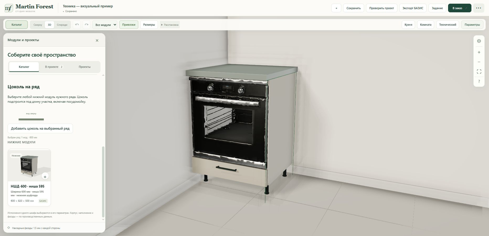
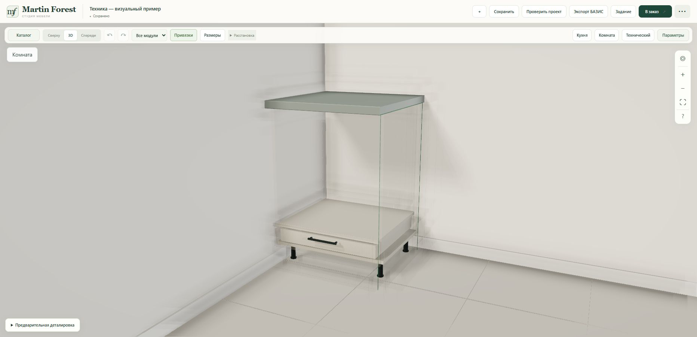

# Tripo oven in НШД-600 — 23 October 2026

The existing optimized oven now appears in the НШД-600 base cabinet and its catalogue thumbnail. The same mesh, material and lazy-loading cache are reused by tall cabinets. No new Tripo operation or charge.

## Placement and scope

- Restricted to the canonical `oven_fixed_niche` production construction (`bazis.9e77f4333545`). Other base cabinets and unknown legacy donors keep their existing visuals.
- The visual oven is 595 × 593 × 550 mm. Its top is 1 mm below the top of the cabinet; its bottom is 1 mm above the existing support panel. It follows the 595 mm niche when body height or leg height changes.
- Native width 600 mm, internal width 564 mm, lower drawer, 18 mm support panel, 595 mm niche, 38 mm countertop, cut list, hardware and BAZIS export are unchanged.
- Normal view shows the oven. Inspection and without-facade modes hide it to expose the construction. Loading/error faceplates remain available.
- Catalogue repaint after lazy asset loading now covers НШД as well as tall appliances.
- The source Tripo model retains the previously documented trim/handle waviness; this change adds placement, not a geometry redesign.

## Verification

- 69 Node checks passed: shared assets, nine body/leg combinations, unchanged production parts, source sink/oven specification, tall appliances and mesh rendering behavior.
- An existing broad width-limit test used floor-cabinet settings for upper cabinets. Its fixture now uses each model's actual tier/base; production rules were not changed.
- Runtime commit: `7c79cda04fd58a038adc9175fcab4967276b05cf`.
- Railway deployment `9adfc085-07f1-4c0e-aca8-da38efe983ea` reached **SUCCESS** at 22:19:36 Minsk time (UTC+3).
- Both changed public modules returned HTTP 200 and matched the committed bytes. The saved project reloaded with the existing НШД and tall cabinet. The oven appears below the countertop and above the drawer, with no browser console errors/warnings.
- Live inspection mode hid the oven and exposed the support/drawer; normal mode restored it. The filtered НШД catalogue card showed the same oven. The user's cabinet positions and dimensions were preserved.
- Existing project **Техника — визуальный пример** already contained the user's НШД and tall cabinet. It was saved before reload; no extra cabinet was added.

## Before

## After — live site

