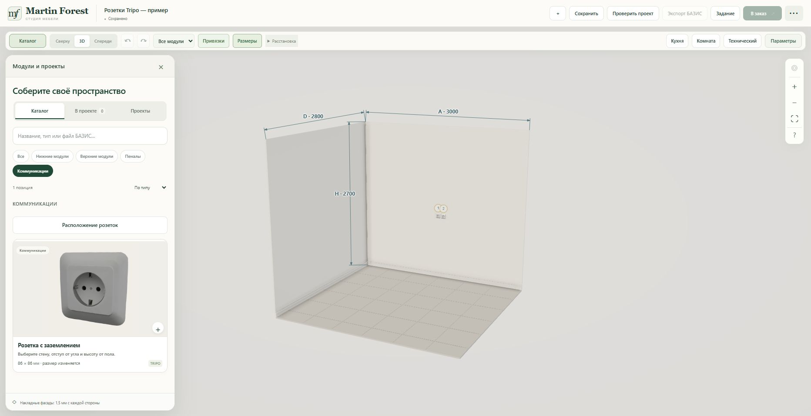
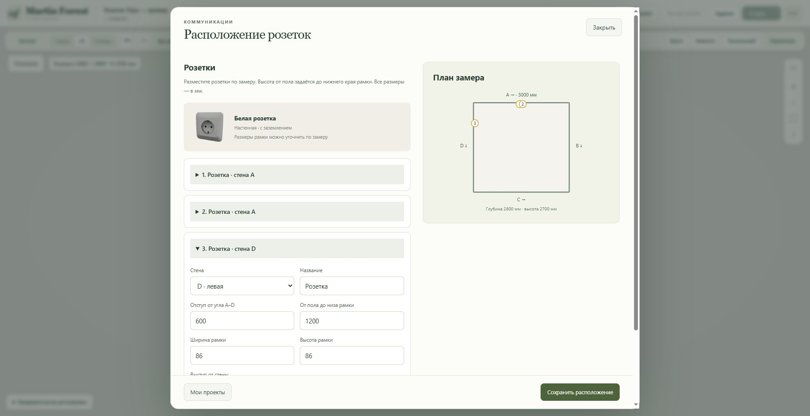

# Communications catalogue — 2026-10-23

The common constructor catalogue now includes **Коммуникации** with the Tripo **Розетка с заземлением** card. Clicking it opens an uncommitted outlet draft in the focused wall-placement dialog. **Расположение розеток** edits existing room outlets without adding another. Wall A/B/C/D, corner offset, floor-to-bottom elevation and frame dimensions use the existing room validation and save path.

The category is available to all constructor projects, not only the demonstration. Electrical outlets remain room features, not furniture items; catalogue dragging/insertion cannot create an invalid cabinet from the outlet card. Furniture catalogue cards keep their normal insertion path. Filtering hides countertop and plinth controls within Communications.

## Release and verification

- URL: https://martin-forest-v2-staging-production.up.railway.app/constructor.html
- Railway service: `martin-forest-v2-staging` (`9aacf7bf-edd5-4f08-9423-3fbabea59268`), the existing working constructor endpoint.
- Source: `mf-communications-20261023`, commit `c5e8e47e58f0942d8b031949f95e8b9e35cdd93b`.
- Deployment `167ba247-1551-466a-8287-e2e0bd7551e4`: SUCCESS, 2026-10-23 16:11:47 UTC.
- No production Bridge, database schema, environment variables or volume changes.
- 17 Node and 2 Python checks passed; syntax and diff checks passed.
- Browser: Communications filter shows one outlet card; card opens a new draft; wall D, offset 600 mm and bottom elevation 1200 mm were saved in the existing separate **Розетки Tripo — пример** project. The edit button reopens all three outlets with the new coordinates retained, and the plan marks wall D correctly. Undo is enabled. Browser warning/error log list empty.

