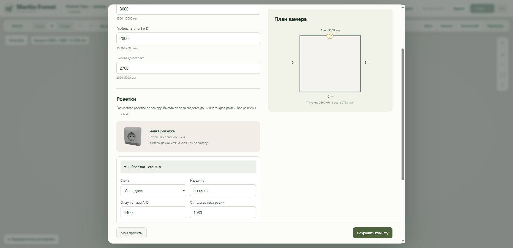

# Live verification — 2026-10-23

Staging: https://martin-forest-v2-staging-production.up.railway.app/constructor.html

- Deployed implementation commit: `f2b92c4782b8b66d47fdeeb7a24f2c501528d239`.
- Railway deployment: `aa2fe6cc-fe5b-4c4c-8448-dec4f8294e38`, status SUCCESS.
- Service: `martin-forest-v2-staging`; production services and private volume configuration unchanged.

## Browser verification

Created a separate saved demonstration project, **Розетки Tripo — пример**. Room 3000 × 2800 × 2700 mm, two 86 × 86 × 12 mm outlets on wall A at offsets 1400 and 1500 mm, bottom-edge elevation 1080 mm. These are demonstration dimensions, not a measured customer installation.

Verified through the visible UI:

- An outlet extending beyond the wall is rejected with a clear validation message.
- Both textured outlets render on the wall in the 3D scene.
- Saving and reloading retains the named project, room and outlet dimensions.
- Adding a third outlet and closing the dialog without saving leaves the two saved outlets intact.
- The measurement plan and placement fields reflect the saved outlets.
- No warning or error entries were returned by the browser console inspection.

Automated validation before release: 17 Node tests and 2 Python tests passed. Four-wall orientation and bounds, undo/redo, shared geometry, stale asynchronous loads and backend roundtrip are covered there.

