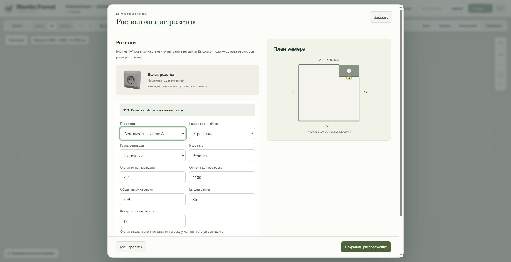
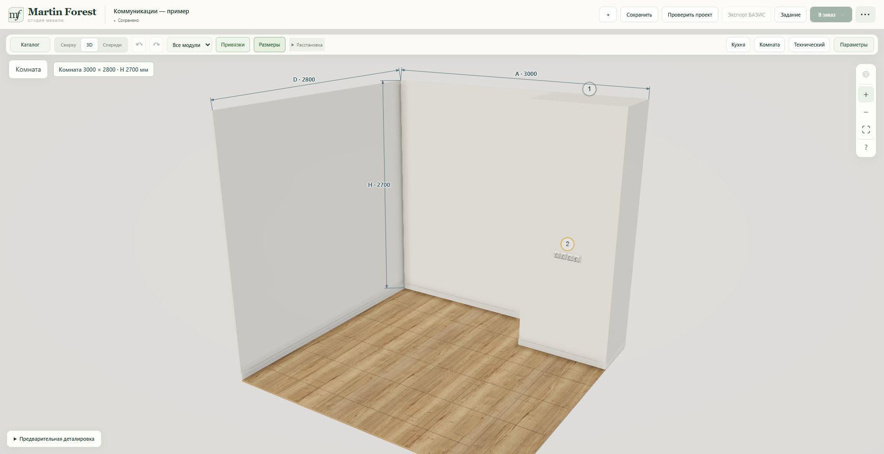

# Outlet blocks on ventilation shafts — 2026-10-23

**Коммуникации → Расположение розеток** now provides a mounting surface selector and a horizontal block of **1, 2, 3 or 4 outlets**. Existing single outlets remain unchanged. Frame width/height and projection remain editable measurements; the initial block widths are 86 / 157 / 228 / 299 mm, not a claim about a particular manufacturer's frame.

Mount an outlet on a normal wall, or on the front/start/end face of an existing shaft or column. Front offsets follow the host wall's measurement direction; side offsets start at the original wall and run into the room. All elevations are from the room floor to the bottom of the whole frame. Mounted outlets follow the shaft's position, depth and wall changes; their local offset stays intact.

Data additions: `socket_count` (1–4, default 1), `mount_id` (optional room-feature ID) and `mount_face` (`front` / `start` / `end`). Client and server validate references, face extents, ceiling/room bounds and solid intersections. Removing an occupied shaft asks the user to relocate/remove its outlets first. Shaft edits cannot save a block that no longer fits.

The existing optimized Tripo geometry/textures are shared by every outlet instance. Multi-outlet blocks have a common backing frame and repeated single socket meshes. No new generation, asset download or subscription charge. Plan previews, scene geometry and project checks use the same measured mounting transformation. Save/load and undo/redo keep the host reference and block count.

## Validation and release

- Node: 84 checks passed, including all four walls × three shaft faces × four block sizes, movement, count changes, shared render assets, invalid placement and history.
- Python: 71 checks passed, including mounted blocks, missing hosts, invalid counts, hidden corner sides and legacy socket/shaft round trips.
- Final room-plan adjustment: 9 focused Node checks passed. Syntax and whitespace checks passed.
- Runtime branch: `mf-socket-blocks-20261023`.
- Runtime commit: `ecc94bce0f7f5b2dacd1fe77e23eae5758564155`.
- Railway service: `martin-forest-v2-staging` (`9aacf7bf-edd5-4f08-9423-3fbabea59268`).
- Deployment: `030e27e1-4635-44f5-b3c6-37cfa6502729`.
- URL: https://martin-forest-v2-staging-production.up.railway.app/constructor.html
- No database migration, production Bridge, environment variable or volume changes.

- Deployment reached SUCCESS at 2026-10-23 17:19:37 UTC with the exact runtime commit above.
- Browser: in **Коммуникации — пример**, saved a four-outlet block on the existing shaft's front face, local offset 351 mm, floor-to-bottom 1100 mm, full frame 299 × 86 × 12 mm. The pre-existing shaft and room dimensions were retained. The Tripo sockets are visibly on the shaft surface.
- Reloaded the page and reopened the editor: mount, face, count and dimensions survived. Switched through 1 / 2 / 3 / 4 and checked the corresponding widths 86 / 157 / 228 / 299 mm. An overhanging block (offset 900) was rejected; restored 351 before saving. Browser warning/error logs were empty.
- Only the existing demonstration was edited; no production orders or messages were submitted.

