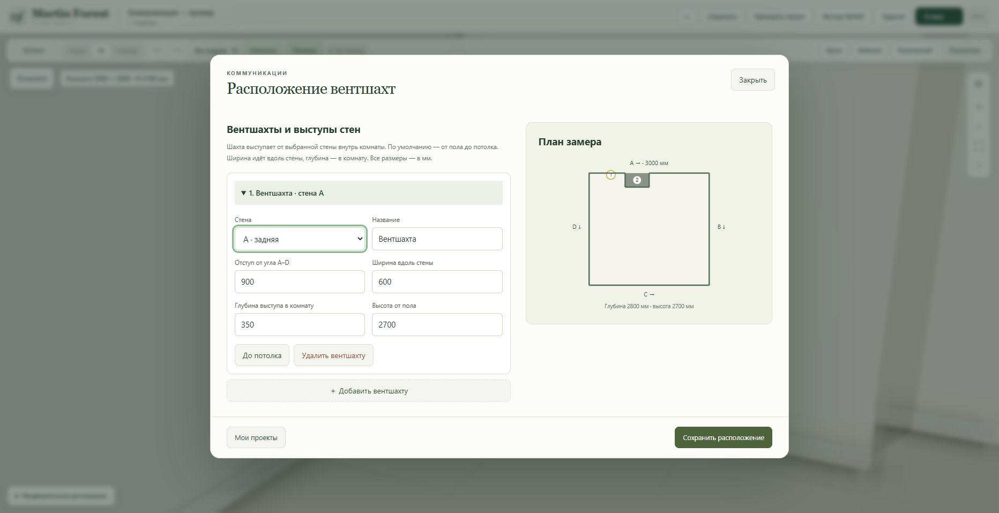
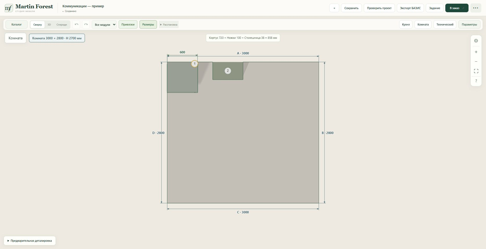
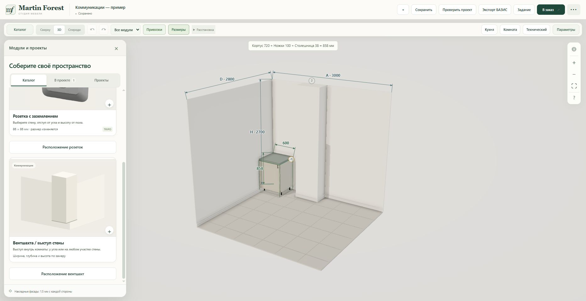

# Measured ventilation shafts — 2026-10-23

The existing **Коммуникации** catalogue includes **Вентшахта / выступ стены** and **Расположение вентшахт**. The card opens an uncommitted room-feature draft; the edit button reopens saved shafts. Choose wall A/B/C/D, the measured corner offset, width along the wall, depth into the room and height. All values are millimetres. New shafts start at the floor and default to the room ceiling; full-height shafts follow room-height edits, while custom heights remain unchanged.

Shafts are dimensioned geometry, not generated meshes. The floor outline steps around their footprint at a corner or in the middle of a wall, including adjoining shafts. The 3D volume shares the room wall finish and has a floor skirting. Cabinet placement, automatic free-space search and countertop checks reject overlap; snapping can use the front and side faces. Saving the room refuses a new shaft that overlaps existing furniture and asks the user to adjust the shaft or move the module. Touching faces are allowed.

Existing room-feature JSON, project saving and undo/redo are reused; `shaft` is an additional supported feature kind. Outlet assets and production integration are unchanged. No database migration or environment/volume changes.

## Validation

- Node: 78 tests passed across room plans, shafts, placement, kitchens, project checks and sockets.
- Python: 12 tests passed for the measured-room schema, asset route and socket regressions.
- JavaScript syntax and whitespace checks passed.

## Deployment

- Working constructor: https://martin-forest-v2-staging-production.up.railway.app/constructor.html
- Service: `martin-forest-v2-staging` (`9aacf7bf-edd5-4f08-9423-3fbabea59268`).
- Branch: `mf-vent-shafts-20261023`.
- Runtime commit: `c24eef255dda74d3fcbebac3b98beb3bd0410fba`.
- Deployment: `b5f410f9-5e2a-459e-850e-f994baaf869d`.

- Deployment reached SUCCESS at 2026-10-23 16:49:43 UTC with the exact runtime commit above.
- Browser: the common Communications filter shows the outlet and shaft cards. Shaft wall A, offset 900, width 600, depth 350, height 2700 was saved in the existing separate demonstration, renamed **Коммуникации — пример**. After a full reload the saved geometry and 900 mm offset were retained.
- Entering offset 2900 rejected the shaft outside the wall. Adding a native one-door base cabinet found a clear position; changing the shaft offset to 0 was rejected with the specific cabinet/shaft collision error. The invalid draft was restored to 900 before saving.
- Visually checked the stepped top plan, floor-to-ceiling 3D solid and catalogue card. The browser warning/error log list was empty. No orders or production messages were submitted.

