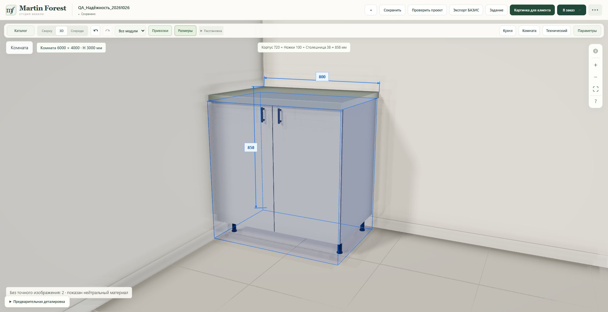

# Universal library search — importer 9.9.6

The importer already recursed below one hardcoded path, so a different common library folder could never be searched. Version 9.9.6 uses the documented native BAZIS directory dialog, remembers the chosen root in per-user settings, and offers re-selection if that root disappears or lacks a required donor. Cancelling stops before model import.

Discovery uses an iterative traversal with no fixed depth/directory cutoff, follows directory junctions with realpath cycle detection, and reports unreadable paths. It matches the exported SHA-256 after a move or rename, caches hashes within the scan and refuses ambiguous unpinned legacy names. Exported path components cannot directly bypass the chosen search tree. Existing production geometry, material, placement, note and source-pin logic is retained.

Original FR3D files are read-only. Only the importer settings and existing export diagnostics are written. The downloadable standalone JS is byte-identical to the served importer. The old version snapshots are kept; tests now exercise the current packaged importer.

Native directory API reference: https://cdn.bazissoft.ru/documentation/ru/BAZIS-Script_functions.html#UI.dialogs.RunDirectorySelectDialog

Native Windows BAZIS execution is not available in this environment; automated tests exercise the documented dialog boundary and filesystem behavior.

## Release verification

- Code commit: `ba459bdbd51461883e2aadddc476964f75d26708`.
- CI [Constructor reliability #9](https://github.com/artempilipeika-create/artempilipieka-create.github.io/actions/runs/40336532956): 683 Node tests and 415 PostgreSQL-backed Python tests passed.
- Railway deployment `17ea3584-206d-45ad-af27-0e8c62a5ce29` reached SUCCESS at 2026-10-26 14:56:40 UTC, on `martin-forest-v2-staging` only. Publication was explicitly approved after the initial automatic approval rejection. No staged changes remain.
- `/health`, `/constructor.html` and the importer returned HTTP 200. The served importer is byte-identical to the tested release: SHA-256 `522fcfa3e95b5477db5f570002625912f3d668bf3281f14aad1b3865ceb46aba` (631706 bytes). The page names the 9.9.6 download.
- Live synthetic project `QA_Надёжность_20261026`: changed width 800 → 900 mm, saved, reloaded and confirmed 900 mm and both doors. Edited back to 800 mm and saved. No customer project was edited and no order/export was submitted.
- Browser warning/error logs were empty. Bounded runtime logs showed normal startup and no application exceptions; proxy logs showed no HTTP 5xx.

