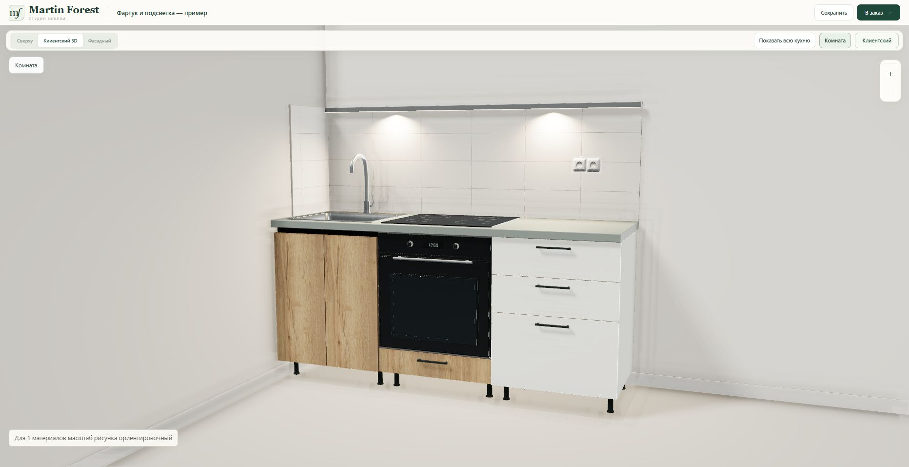
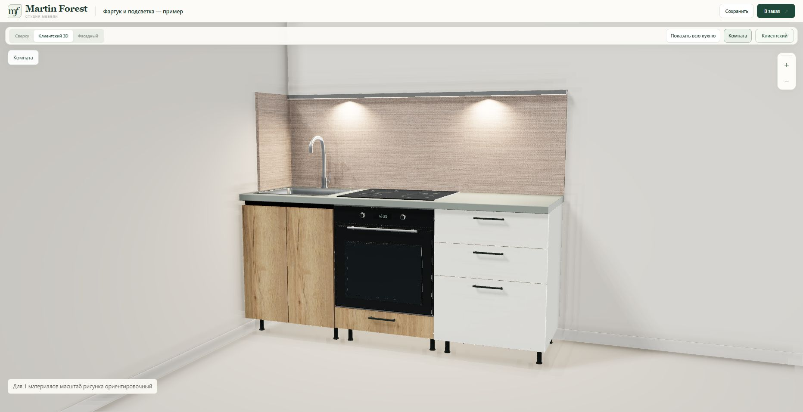
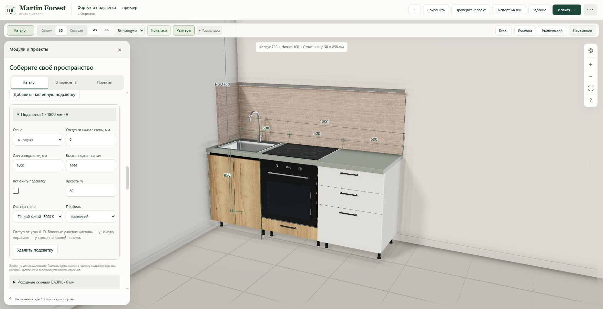

# Fourth visual improvement — wall panels and wall lighting

Three presentation finishes: 6 mm skinali, 16/18 mm catalogue LDSP, and 8/10/12 mm tile. Straight, left, right and U shapes share one card. All four uploaded BAZIS fragments are preserved byte-for-byte and downloadable from the card. Their measured default envelope is 2000 × 600 mm, with 400 mm return depth for corner shapes. Main panel thickness is 6 mm; return panels start after that thickness (394 mm native return pieces). `wall-panel-sources.json` records hashes, material name and elastic planes, without extracting licence metadata.

Placement uses measured room walls A–D, wall-start offset, width, elevation and height. Row-based initial placement respects cabinet rotation and 38 mm worktop elevation. Changes are explicit thereafter. Left/right means the start/end of the main wall segment, matching the dimensioned offset origins. Architectural openings are clipped in the visual mesh. Existing socket measurements are retained; socket geometry is offset to the finished face, including matching return faces. Shaft-mounted sockets retain their host geometry.

LDSP uses the exact selected catalogue material and its existing texture/appearance metadata. Without a selection it displays a labelled placeholder colour. Skinali and tile use editable generic colours, without impersonating the native source's unprovided decor image. Tile dimensions and grout width/colour are editable, with batched instanced tile faces.

Wall-mounted lighting has a visible aluminium/black profile, diffuser and two downward spot lights. Controls: wall, offset, length, elevation, on/off, brightness and 2700/3000/4000 K. At most four profiles (eight lights); no extra shadow maps. There is no cabinet-milled lighting option in this feature.

## Persistence and production boundary

Additive validated `scene.wallPanels` / `scene.wallLights` collections retain old-project compatibility, exact LDSP material identities, autosave, undo/redo and project copy/restore. Invalid dimensions, unsupported thickness, duplicates and unbounded counts are rejected. Rendering skips out-of-room elements with a visible editor warning while dimensions are corrected.

These are visual assemblies, excluded from price, cut lists and automatic native BAZIS imports. The UI and project checker state that boundary. JSON export includes a wall-finish schedule with source provenance, dimensions and a manual-adjustment note; the designer's project brief includes the elements. Native sources remain 6 mm rather than being falsely represented as 18 mm or tile. No CNC cut-outs, wiring or construction instructions are inferred.

No production orders, Telegram messages, production infrastructure, volume configuration or database schema changes.

## Local verification

- 52 Node tests passed across wall finishes (15), camera framing, materials, room plans, worktop fixtures and autosave.
- 119 Python tests passed across new source/validation/allowlist checks, materials, fixtures, socket blocks and shafts. One existing Starlette/httpx deprecation warning.
- Source hashes and native panel counts/thickness/envelopes checked directly with the FR3D parser.
- Geometry coverage on four walls, butt joints, socket offsets, overlapping opening subtraction, tile batching, light state/resource disposal, correct row rotation and history roundtrips checked.
- Syntax/compile and git whitespace checks passed.
- Broader production-notes suite exposed one pre-existing stale source-regex test (`const extension=a.microwave?9.5:0`) removed by the earlier appliance visual refactor. Neither that test nor the appliance mesh implementation changed here. Other tests in that exploratory run passed (42/43); it is not a new functional failure.

## Release

Runtime commit: `e0bd898091e2a160c45784ed79e428bc027e4c6c`.
Runtime tree: `a0ed5861c7f86271499ade8e4af1bff000a725a8`.
Existing isolated Railway service: `martin-forest-v2-staging`.
Site: https://martin-forest-v2-staging-production.up.railway.app/constructor.html

Final runtime commit: `02aa73fae74657cc734f00d4cd1bbde879613163`.
Final runtime tree: `312f55ff9173e24be3318fbc8e28a7f8b869dbcc`.
Final deployment: `fdaf1768-f5a4-4866-a7f7-7e044cba1b8a`, **SUCCESS** at **00:44:25 Minsk (UTC+3), 24 October 2026**. Service remains pinned to that runtime commit; evidence commit does not deploy.

## Actual browser verification

- Separate copy **Фартук и подсветка — пример**, preserving earlier demo projects.
- Added 1800 × 600 mm backsplash at elevation 858 mm, offset zero on wall A, with left 400 mm return.
- Switched skinali → tile → LDSP → tile. LDSP thickness 18 mm and exact catalogue selection **ЛДСП Ultradecor 18мм Тессеа серовато-бежевый K541 PN** survived save/reload and rendered its existing catalogue texture.
- Changed tile dimensions to 300 × 150 mm. Undo restored the prior 300 mm height; redo restored 150 mm. Final tile and lighting survived save/reload.
- Added 1800 mm wall profile at elevation 1444 mm, brightness 80%, 3000 K, aluminium. Turning it off removed the visible light pools; turning it on restored illumination.
- Added a two-socket block at wall A, offset 1450 mm, bottom elevation 1100 mm. The sockets remain visible on the finished tile face.
- The copied scene had no saved worktop fixtures; sink and hob were added only to this new visual demo. These also persisted after reload.
- Camera framing now includes backsplash/profile extents; a regression test verifies it still excludes them from selected-cabinet framing.
- No browser warning/error logs after final reload. Five served JS/CSS files matched local bytes, and `/health` returned 200.
- Final tab left open in client view.

