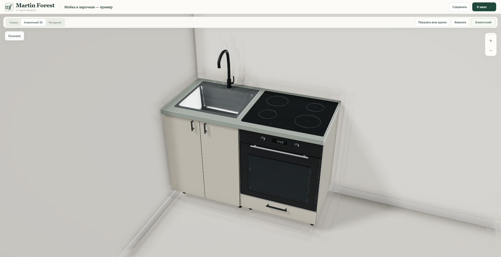
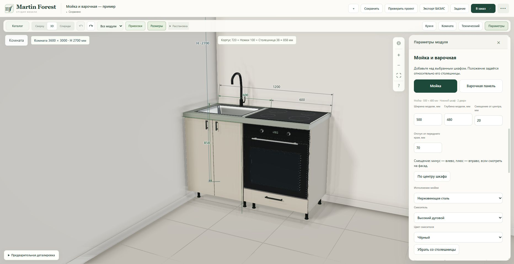

# Мойка и варочная — 23 October 2026

Second item of the agreed improvement list: place a sink or hob over the selected lower cabinet, set its exact position on the worktop, and choose faucet variants.

## Delivered

- New inspector block “Мойка и варочная”, with a shortcut in the catalogue's worktop card.
- One fixture per selected BAZIS lower cabinet: sink or four-zone glass hob. Width, depth, offset from cabinet centre, and front-edge distance use whole millimetres. The fixture moves and rotates with its host.
- Sink finishes: stainless steel / black. Faucets: tall arch / angular / compact, chrome or black.
- Smooth analytic meshes, a tapered open bowl with drain, rounded faucet tubes, and an actual hole in the rendered worktop. No Tripo job or credits were used.
- Multiple independent fixtures can share one worktop. Shape containment rejects edge and seam crossings; width and front/rear margin checks reject out-of-bounds placement. Worktop disabling requires removing the fixture first.
- Additive nullable `FurnitureItem.worktop_fixture` settings survive server JSON, the existing normalizer, project restore, local autosave, and undo/redo. Existing projects require no migration. The 2D fallback draws fixture footprints.

These are unbranded presentation models, not manufacturer installation specifications. The rendered holes do not change native FR3D contours, production parts, prices or BAZIS machining. The UI explains that cutouts and cabinet internals must be checked against the selected appliance's installation drawing. Bridge, database schema, integration settings, orders and production files were not changed.

## Verification

- 47 targeted Node checks passed across new fixtures, countertop geometry, accessories and appliance smoothing.
- 90 final Node checks passed across fixtures, core geometry, existing visuals and appliance loading. This overlaps the first run; counts are not additive.
- 17 Python checks passed for validated save/restore, invalid data and asset allowlisting, plus existing accessory behavior. Only the existing Starlette/httpx deprecation warning was reported.
- All four rotations tested. Removed worktop cap area equals the opening area; production parts and native run data remain unchanged. Per-instance fixture geometry and materials are disposed once.
- Live demo **Мойка и варочная — пример**: a native sink cabinet plus НШД with a hob. All three faucets switched successfully. A 20 mm horizontal offset and 70 mm front margin survived save/reload; a 300 mm offset was rejected and restored to 20 mm. Undo restored the previous faucet. No browser warnings/errors captured.
- Six served JS/CSS resources returned HTTP 200 and matched committed SHA-256 hashes.
- Runtime commit: `ba1dd30c1a72735c1406f5e0a7cd1d6638dff506`, tree `a59a6a3c757b040140a96c903fe65dce49b0553a`.
- Railway deployment `bbdbc843-dbc0-4839-b573-585a7533a686`: SUCCESS at **23:17:55 Minsk (UTC+3)** on 23 October 2026. Existing isolated service remains pinned to the runtime commit.
- Site: https://martin-forest-v2-staging-production.up.railway.app/constructor.html

## Actual live browser screenshots

